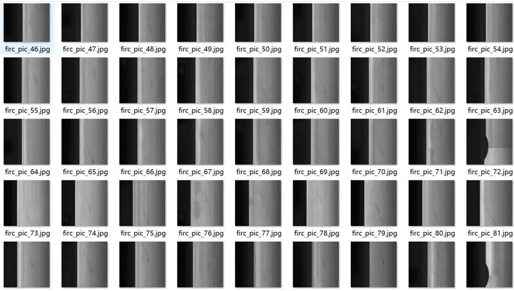
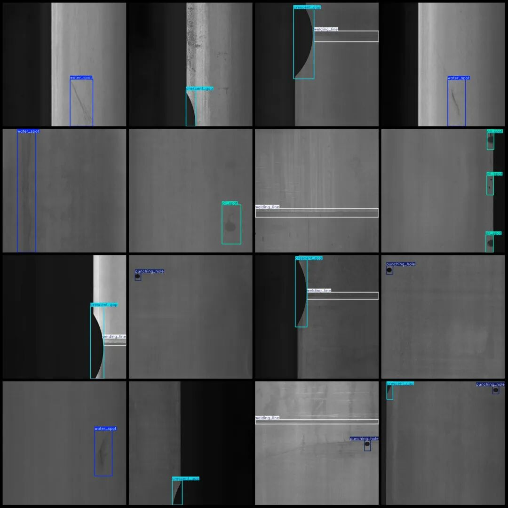
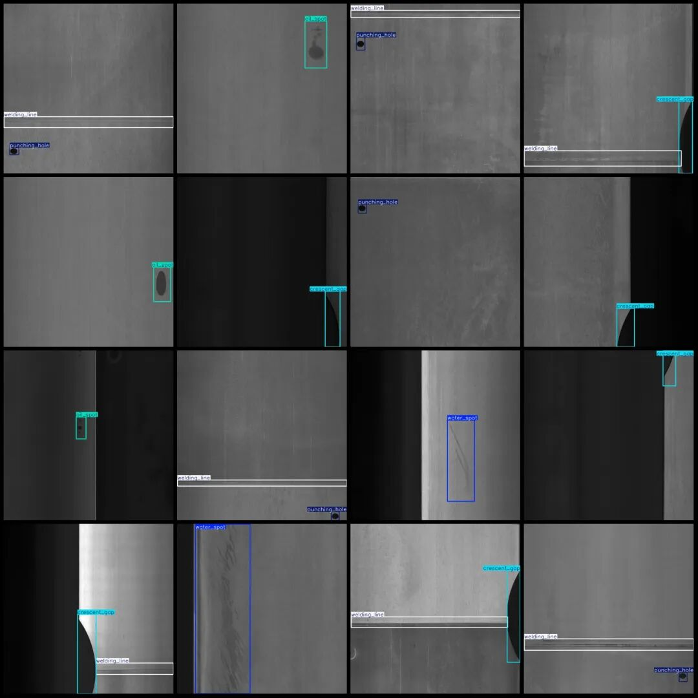

# Steel Surface Defect Detection Dataset VOC+YOLO format with 1196 images in 5 categories

Dataset format: Pascal VOC format + YOLO format (txt file without split path, only containing jpg images and corresponding VOC format xml files and yolo format txt files)

Number of images (number of jpg files): 1196

Number of annotations (number of xml files): 1196

Number of annotations (number of txt files): 1196

Label category count: 5

Label category names (note that the order of yolo format categories does not correspond to this, but is based on the labels folder's classes.txt): ["crescent_gap", "oil_spot", "punching_hole", "water_spot", "welding_line"]

Number of boxes labeled in each category:

crescent_gap (Moon Shape Gap) frame count = 313, occupying picture count = 312.

Oil spot (spot) frame count = 344, occupying picture count = 218

Punching_hole (Drilling) frame count = 345, occupying picture count = 340.

Water spot (water spot) frame count = 355, occupying picture count = 295.

Welding_line (welding line) frame count = 518, occupying picture count = 516

Total frame count: 1875

Image resolution: 640x640

Using labelImg:

Annotation rules: Draw a rectangle around the category.

Important Notice: The dataset does not have separate training, validation, and test sets; you need to partition them yourself.

Special : This dataset does not guarantee the accuracy of the trained models or weight files.

Image Preview:

Annotation example:

## Payment

Here is a pay link on Stripe ( https://buy.stripe.com/3cs8yP7sY87d0vu9AB ). Please contact me lonlonago@foxmail.com after funding $89, and I will send you a complete data files , thank you!

